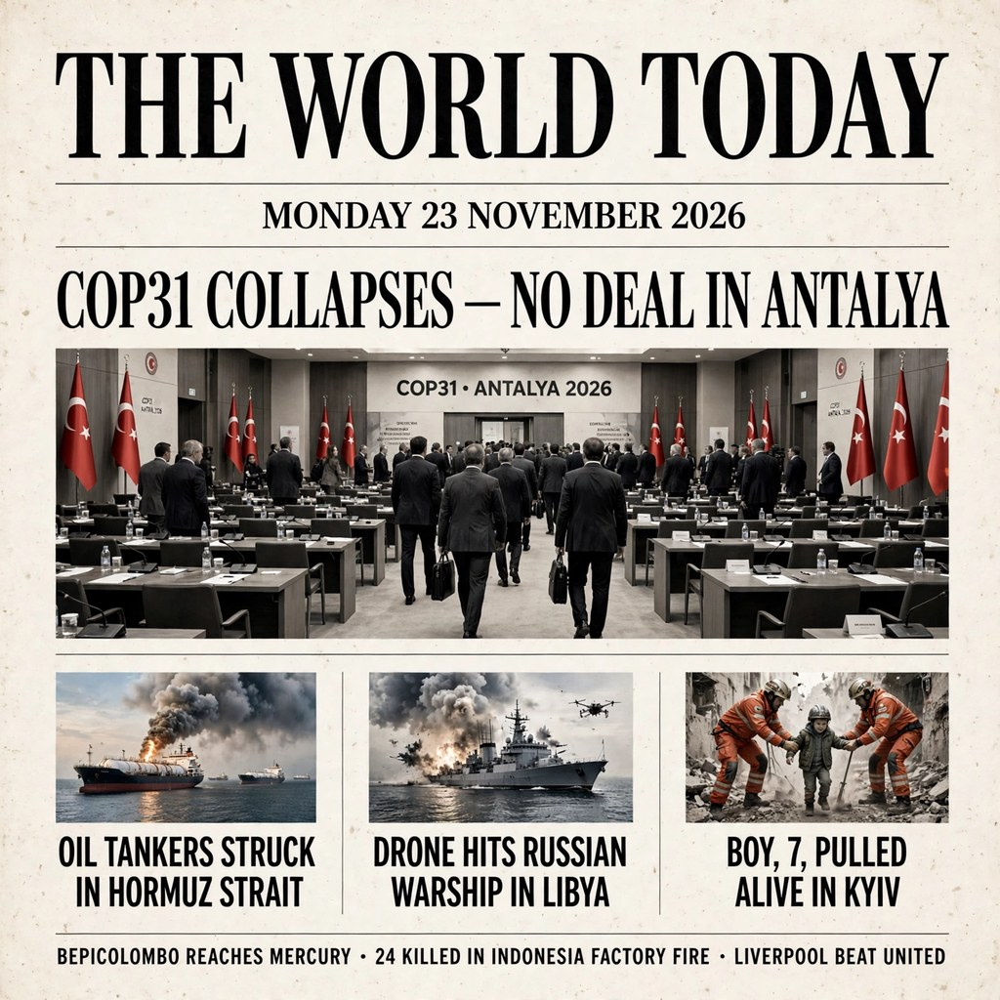

# THE WORLD TODAY — Monday 23 November 2026

[](https://make.fun/c/news-image-20261123)
[](https://make.fun/c/news-image-20261123)
[](https://make.fun/c/news-image-20261123)

Entry for the make.fun bounty [Sum up 23 November's world news in one image](https://make.fun/c/news-image-20261123).

## The image

A newspaper front page, **THE WORLD TODAY**, dated **MONDAY 23 NOVEMBER 2026**,
summing up the day's world news in one picture.



## Stories pictured

- **COP31 collapses — no deal in Antalya.** The climate talks fail over
  fossil-fuel phase-out language; the EU and UK reject the pact.
- **Oil tankers struck in the Strait of Hormuz.** Iran's navy says two more
  tankers caught fire on Sunday; shipping attacks at their highest level
  since the war began.
- **Drone hits Russian warship in Libya.** Suspected Ukrainian sea drones hit
  the corvette Merkury at Benghazi naval base; the ship is severely damaged
  and later capsizes, 10 injured.
- **Boy, 7, pulled alive in Kyiv.** A Russian drone hits a five-storey
  apartment block in Dymer, north of Kyiv; 2 killed, 11 missing.
- **BepiColombo reaches Mercury.** The mission enters orbit around Mercury
  (21 November) — only the second mission ever to do so.
- **24 killed in Indonesia factory fire.** A candy factory fire in Cikande,
  Banten; 24 bodies recovered.
- **Liverpool beat United.** Liverpool beat Manchester United in Mauricio
  Pochettino's debut as United manager; FIFA to confirm the UK as host of
  the 2035 Women's World Cup.

## How it runs

`main.ts` (Node 22, standard library only) copies `entry.png` to
`$MAKEFUN_OUTPUT_DIR/entry.png` (default `/output`), creating the directory
if needed. It takes no input and writes the same bytes on every run:

```sh
mkdir -p out && MAKEFUN_OUTPUT_DIR=out node main.ts
```

Deterministic: two runs write byte-identical files (same sha256), and the
image is 1024×1024 at 269,295 bytes, under the 1 MiB cap.

## Sources

Stories as reported on 23 November 2026 by the major news wires and outlets
covering COP31 in Antalya, the Strait of Hormuz shipping attacks, the
Benghazi naval base strike, the Dymer apartment strike, the BepiColombo
Mercury orbit insertion, the Cikande factory fire, and the Premier League.

## License

MIT — see [LICENSE](LICENSE).
